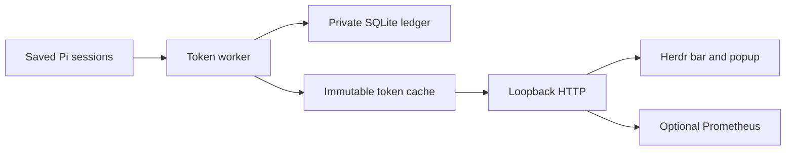

# Token Garden

A local Python app for saved Pi token usage, with a Herdr tab-bar readout and terminal popup. No Pi extension is required.

## Run from source

Python 3.12+ on macOS/Linux, with curses support:

```sh
python3 -m venv .venv
.venv/bin/python -m pip install -e .
sh garden.sh serve
```

Run these in another terminal:

```sh
sh garden.sh status
sh garden.sh ui
sh garden.sh show --window 24h
```

**h** selects the last hour; **d**, the last day. Arrow keys/Page Up/Page Down scroll; **q** or Escape closes. Sparklines use per-model scales, oldest to newest.

For a snapshot without a server:

```sh
sh garden.sh scan
sh garden.sh show --offline --window 24h
```

The source wrapper uses `.venv` and `.state` beside `garden.sh`. An installed `token-garden` command is also available. **Pass `--state /absolute/path/to/private-state` to installed collector/offline commands**: the current default is relative to the installed package, not a user data directory. All collector and offline commands must use the same state directory. Do not run two collectors against one ledger/port.

## Herdr (optional)

Review `herdr-config.example.toml`, replace `/absolute/path/to/token-garden` with your checkout, and merge only its entries into your configuration. Check shortcut conflicts and preserve unrelated entries. Configuration reload and service installation are manual, opt-in operations.

`herdr-plugin.toml` offers a terminal overlay or split. It requires the source checkout's `.venv`; it is not installed by the Python wheel. Herdr 0.9.0+ is declared by the plugin manifest. Integration examples do not install background services.

## What counts

- Reads saved JSONL under `~/.pi/agent/sessions/`; repeated `--sessions PATH` on `serve`/`scan` overrides the default roots.
- Counts fresh input, output, cache reads, and cache writes. The total includes all four.
- Attributes each response to its recorded provider/model; missing attribution stays `unattributed`.
- Counts abandoned branches and deduplicates copies retaining ID, timestamp, kind, model, and usage. Embedded compaction tails are not counted again. Imports regenerating IDs cannot be deduplicated this way.
- Holds incomplete trailing records until the next scan. Malformed entries, inaccessible sources, and unsupported session versions show partial coverage. Valid usage on aborted/error responses still counts.
- Excludes ephemeral `--no-session` runs and unreported provider work. No costs, quotas, billing estimates, process monitoring, or diagnosis.

The worker reconciles every five seconds. HTTP reads cached snapshots, not SQLite. Missing, partial, stale, and offline states remain explicit; snapshots become stale after thirty seconds without a successful scan.

## Privacy and operation

Session files are read-only. The SQLite ledger retains thirty days of usage metadata and ingestion checkpoints, **including local source paths**, but not conversation bodies. Provider/model names appear in the UI/API/metrics; avoid sensitive model aliases. Keep the ledger, sessions, logs, and monitoring storage private. Do not attach them to issues or releases.

The collector binds to `127.0.0.1:9467` with Host guards. Read-only endpoints:

- `GET /usage?window=3600`
- `GET /usage?window=86400`
- `GET /metrics`

`--port PORT` changes the collector/client port. Loopback is not authentication against other local processes; do not expose the collector through a public proxy.



`prometheus.yml` is an optional loopback scrape example. Token window totals are **gauges**: do not apply `rate()` or `increase()`. Choose private monitoring storage and retention deliberately; the app does not manage Prometheus or system services.

## Development and release checks

Install Nix with flakes enabled. In a Git checkout:

```sh
nix develop
jj git init --colocate       # once, in this checkout; needed by Shaka's file listing
just check
```

`flake.lock` pins Shaka, Nixpkgs, Python 3.12, uv, just, and repository linters. `uv.lock` pins Python dependency versions and hashes. `just setup` uses `.release-venv`, leaving any app `.venv` alone. No global configuration is required.

- `just validate`: Ruff lint/format, strict mypy, all tests, and separate **90% branch-aware coverage gates** for `garden` and release tooling.
- `just smoke`: build sdist, build wheel from that sdist, strict Twine metadata checks, exact archive inventories, and installed-wheel smoke in an isolated interpreter with synthetic sessions/private temporary state. Runtime dependencies use exported lockfile hashes.
- `just repo-check`: Shaka whitespace and preflight (including typos, actionlint, workflow accounting, and TOML formatting).
- `just check`: all the above; CI runs this same gate on Linux and macOS.

**Shaka limitation:** its schema has no Python kind and `shaka build` is a stub. There is deliberately no fake `project.cue`. Its project checks discover zero projects; Python recipes, not Shaka's project loop, enforce application checks and assemble packages. The handwritten workflow is explicitly accounted for in `.shaka/repo.cue`. Colocated `.jj` is local metadata, not a second checkout; Git commits remain the release history.

Packages appear in `dist/`; fixture reports appear in `reports/`. Neither is tracked. The wheel contains only `garden` modules and Python distribution metadata. The sdist additionally includes synthetic tests, release tooling, portable examples, docs, specs, lockfiles, and CI configuration. Explicit inventory checks reject extra files, missing source, and unsafe archive entries. Keep application state and environments out of both.

CI caches uv downloads under keys including both lockfiles and package metadata; it never caches app state or environments. Uploads are limited to coverage/JUnit reports and the inspected wheel/sdist, with seven-day retention. Actions are pinned to commit SHAs; no publishing credentials or write permissions are used. GitHub-hosted execution is still unverified until a remote and a run are separately authorized.

See [architecture](architecture.md), [decisions](architecture-decision-record.md), and [release scope](specs/public-release.md).

## Release status

Licensed under either the [MIT License](LICENSE-MIT) or [Apache License 2.0](LICENSE-APACHE), **at the recipient’s option** (`MIT OR Apache-2.0`). Copyright 2026 Jon Edwards. Both license texts ship in the wheel and source distribution.

Publication is not automated. No repository, package registry, or release upload is created by local checks. Confirm package name/version and publication approval before distributing.
