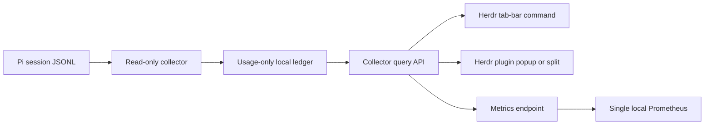

# Token garden for Herdr

A small, local view of Pi token usage by model: an always-visible Herdr tab-bar summary and an expandable terminal popup. This is a design draft, not approval to install services or change Herdr configuration.

## Why

Multiple Pi sessions make it hard to see which models are doing the work and how much usage accumulates over an hour. The garden answers that at a glance, without opening a monitoring dashboard or exposing conversations.

## Narrative

Alex has three agents running in Herdr before lunch. A small `🌱` readout in the tab bar shows the two busiest models. “Which one is eating the context?” he wonders, and opens the garden popup. Nord-colored sparklines show the last hour; the breakdown reveals that most of one model's traffic is cache reads, not fresh input.

He closes the popup with Escape and returns to his agent. Later, after waking the laptop, the garden says `indexing` while catching up instead of pretending usage is zero. When the collector stops, the readout changes to `offline`; his terminals keep working.

## Experience

- **Tab bar:** `🌱 <model> <tokens>/h · <model> <tokens>/h · +N`, ranked by last-hour total. Values are illustrative placeholders here, not measured usage. Short names must distinguish models that would otherwise collide.
- **Popup:** a compact Nord palette, one row per provider/model, a shared time axis with per-row scale labels, and input/output/cache-read/cache-write totals. Show the busiest rows first; scroll when they do not fit.
- **Window:** toggle between last 60 minutes and last 24 hours. The bar always uses the last 60 minutes. The popup uses 12 five-minute buckets or 24 hourly buckets, with the window and scale clearly labeled.
- **Interaction:** configurable shortcut, initially proposed as `Ctrl+B`, then `T` if unassigned. Escape closes only the popup. Optionally open the same view in a persistent split.
- **Health:** distinguish ready, indexing, partial coverage, stale, and offline. Empty-but-healthy says `no usage`, not offline. Hide the optional bar content when Herdr yields space to tab controls.

**Decision:** use Herdr's existing command status area and plugin terminal surfaces. No fork, browser embedding, or custom native sidebar widget.

## Counting contract

“Tokens/hour” means tokens recorded in the trailing wall-clock hour, not an active-time average or an extrapolated generation speed.

| Concern | Contract |
| --- | --- |
| Sources | Saved Pi JSONL sessions under `~/.pi/agent/sessions/`, across working directories. Additional roots can be explicitly configured. |
| Events | Top-level assistant messages and usage-bearing tool results, compactions, and branch summaries. Never recount messages embedded in a compaction's `retainedTail`. |
| Attribution | Use each assistant message's recorded provider/model, not the session's current model. Usage without explicit model attribution appears as `unattributed`; do not guess a nested tool's model. Gateway aliases remain recorded aliases. |
| Categories | Use Pi's normalized `input`, `output`, `cacheRead`, and `cacheWrite` fields. Total is their sum; do not add `totalTokens` again. Reasoning is not an extra category added to output. |
| Time | Use the persisted entry timestamp. At query time `now`, include events in `(now - window, now]`; bucket in UTC and show local-time labels. Future-dated or invalid timestamps are diagnosed and excluded until eligible. |
| Copies | Count a copied event once across forks/clones/imported copies. Dedup identity includes entry ID, timestamp, entry kind, attribution, and normalized usage, not filename or short entry ID alone. Pi's current fork/clone paths preserve those fields. Imports that regenerate IDs are outside this guarantee. |
| Branches | Count all original usage-bearing entries, including abandoned branches: the work already happened. Resuming or navigating the tree does not spend those tokens again. |
| Missing usage | Never estimate tokens from text length. Missing/invalid fields and unsupported session versions produce coverage diagnostics, not silent zeros. Valid zero usage is legitimate. |
| Failures | Count valid reported usage on aborted/error responses. Unreported provider work cannot be recovered; this is observed usage, not a billing ledger. |

**Boundary:** ephemeral `--no-session` runs, undisclosed extension calls, and sessions outside configured roots are not observable. State this coverage in the popup. Exact equivalence with subscription quotas or provider invoices is not promised.

## Local architecture

**Decision:** the local ledger is the counting authority. Herdr reads exact event-window aggregates from it; Prometheus records the same aggregates for monitoring, but is not required for the widget to work. This avoids scrape interpolation and false usage spikes when old files are discovered.

- Proposed store: SQLite, containing only event identities, timestamps, attribution, usage categories, and ingestion checkpoints. No message bodies, tool arguments/results, or working-directory labels in UI or metrics.
- Initial scan indexes existing history; subsequent scans process new/changed files. Polling reconciliation catches events missed by file notifications. Hold incomplete trailing JSONL records for the next scan; diagnose malformed complete records without discarding later valid entries.
- One local writer. Event insertion and file checkpoints commit together. Restart, rename, truncation, rewrite, and repeated scans must not create extra usage. Source deletion does not undo already observed usage.
- Proposed retention: 30 days of event metadata, plus dedup/checkpoint state needed for safe rescans. Older events are excluded before insertion; copied history keeps its original timestamp. Startup prunes expired records even after sleep.
- Collector API and Prometheus bind to `127.0.0.1`; use a persistent Prometheus data directory and bounded retention. No cluster, Kubernetes, Pushgateway, Grafana, or remote write.
- Expose window-total gauges labeled only by provider, model, token category, and fixed window (`1h`/`24h`), plus collector health and coverage metrics. Session IDs, paths, prompts, and credentials are not metric labels. Do not publish historical ingestion as a fresh counter increase.
- Source sessions are read-only. Plugin source/config/state follow Herdr's separate directories; ledger files have user-only permissions. Preserve unrecognized Herdr settings and existing keybindings during opt-in installation.

## Refresh and lifecycle

Proposed defaults: reconcile every 5 seconds and refresh visible UI every 5 seconds. A newly persisted event should appear within 15 seconds after initial indexing. Mark data stale after 30 seconds without a successful collector refresh; health reflects collection progress, not the timestamp of the last model response.

The bar command has a 2-second timeout and prints a successful, sanitized one-line `offline` or `stale` label when it can reach no fresh data. Herdr clears failing command entries, so command failure alone is not the status mechanism. The popup shows cached numbers only with an explicit freshness warning; no cache means an unavailable view, not zero usage. Prometheus failure does not stop collection or Herdr queries.

On macOS, propose a user LaunchAgent for the collector and one for Prometheus. Herdr startup hooks are one-shot, not daemon supervisors. Installation, service startup, config reload, and choosing the actual shortcut require the operator's approval. Uninstall stops only garden-owned processes and removes only its Herdr entries; deleting usage state is a separate choice.

## Acceptance criteria

- Given fixture events on window/bucket boundaries, when querying either window, then category totals, model ranking, and sparkline buckets match the counting contract exactly.
- Given a model switch, two simultaneous sessions, fork/clone copies, and a retained compaction tail, when ingesting twice and restarting, then each original usage event contributes once to its recorded model or unattributed row.
- Given a partial final line, malformed complete entry, missing root, or unsupported version, when collection continues, then later valid events appear and coverage diagnostics remain visible. A missing configured root never looks healthy.
- Given a healthy idle collector, when an hour passes without usage, then the bar becomes `no usage`. Given a stopped collector, then the UI shows stale/offline rather than a zero or an unmarked old total.
- Given Herdr 0.9.0 and the existing Nord configuration, when opening and closing the popup, then the underlying agent and layout remain intact, terminal-width limits are respected, and the compact bar does not crowd tab controls.
- Given Prometheus is stopped or restarted, then the garden remains usable and a historical rescan cannot appear as current token consumption in exported window gauges.
- Given installation is approved, then a manual smoke verifies live Pi usage, collector restart, laptop sleep/catch-up, popup scrolling/close, and uninstall without changing unrelated Herdr configuration. Fixtures cover private-data exclusion and source files remain unchanged.

## Non-goals and approval surface

No cost/billing view, quota enforcement, alerts, per-project ranking, cross-machine aggregation, native Herdr UI changes, or live-stream token counting in this version.

**Already agreed:** local garden, tab-bar summary, expandable Herdr popup, and a single Prometheus instance rather than a cluster.

**Proposed defaults to approve before implementation:** 30-day ledger retention, the refresh/health bounds above, user LaunchAgents, and the available popup shortcut. Owner: the operator. The remaining implementation language/package choice belongs in the implementation plan, not the counting contract.

## References

- [Herdr 0.9.0 configuration](https://raw.githubusercontent.com/herdrdev/herdr/v0.9.0/docs/next/website/src/content/docs/configuration.mdx): command status entries and popup shortcuts.
- [Herdr 0.9.0 plugins](https://raw.githubusercontent.com/herdrdev/herdr/v0.9.0/docs/next/website/src/content/docs/plugins.mdx): terminal placements, state directories, and startup-hook limits.
- [Pi session format](https://github.com/earendil-works/pi-mono/blob/main/packages/coding-agent/docs/session-format.md): checked against installed Pi 0.85.1 docs and fork/clone implementation.
- [Prometheus overview](https://prometheus.io/docs/introduction/overview/): standalone pull-based monitoring, not exact billing accounting.
